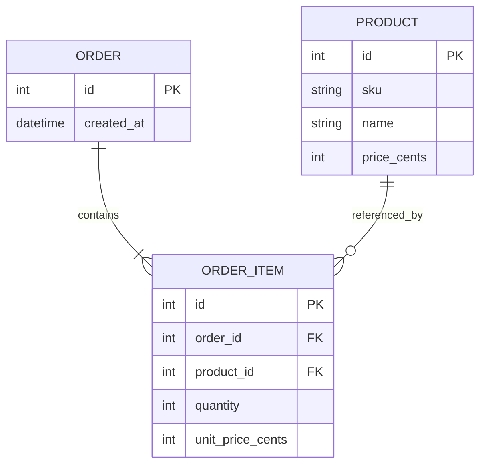
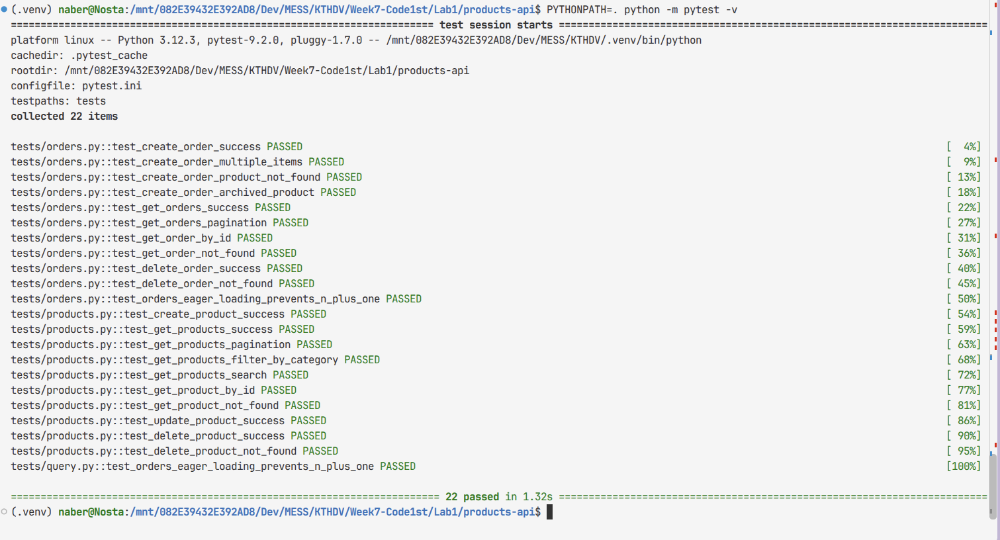

# Product API

## Đề bài

Xây dựng Product API CRUD hoàn chỉnh:

- Viết service Flask có 6 endpoint cho Product API.
- Tích hợp SQLite/PostgreSQL.
- Sử dụng application factory, blueprint, marshmallow schema và SQLAlchemy 2.x.

Mở rộng:

- Thêm một resource OrderItem liên kết Order và Product.
- Đóng container (docker) và chạy thử image.
- Viết pytest cho endpoint có eager loading.

Quan hệ dữ liệu:



## Sản phẩm

Hiện thực hóa theo quy trình Code First, sau đó thông qua blueprint để sinh thông tin đặc tả chi tiết.
Tài liệu được trình bày tại [API Specs](openapi.json).

Việc build container cần thực hiện với:

```terminal
docker build -t products-api
```

## Chạy chương trình

Việc khởi chạy hệ thống có thể thực hiện với hàm `main` có sẵn tại `app.py` (application factory), hoặc thay thế bằng `seed.py` (khởi tạo dữ liệu sẵn cho Database).

```terminal
    # Giả định con trỏ đang ở Week7.Lab1.products-api

    # Chạy application (không khởi tạo dữ liệu)
    python3 -m src.app      

    # Seed dữ liệu giả và chạy app luôn
    python3 -m src.seed

```

Cấu trúc thư mục như sau:

```plain
products-api/
├── .env.example
├── requirements.txt
├── README.md
│
├── seed.py                      # khởi tạo giá trị ảo và database
├── app.py                       # create app (Factory)
│
├── test/...
└── src/
    ├── extensions.py            # For integration: db, migrate, ma, api
    │
    ├── handler
    │   ├── config.py            # env loader
    │   ├── exception.py         # exception schemas & handler (error to response)
    │   └──  exception.py        # logging handler
    │
    ├── models/                  # SQLAlchemy 2.x typed Mapped
    │   ├── orders.py            # order & orderItem
    │   └── product.py           # product
    │
    ├── schemas/
    │   ├── product.py           # ProductOut / ProductIn / ProductPatch / ListQuery
    │   ├── order.py             # OrderIn / OrderOut
    │   └── order_items.py         # OrderItemIn / OrderItemOut
    │
    └── views/
        ├── products.py          # products_bp
        ├── orders.py            # orders_bp
        ├── order_items.py       # order_items_bp
        └── health.py            # health_bp
```

## Kết quả chạy test sơ bộ

